<div align="center">


# Kurio · NFT Marketplace

Marketplace de NFTs em React e TypeScript, com catálogo, carrinho, checkout com carteira simulada, conta do colecionador e preços em tempo real.<br />
O backend inteiro roda no navegador com MSW, inclusive o Socket.IO, então dá para abrir e usar sem nenhum serviço externo.

[](https://desafio-junglegaming-two.vercel.app)
[](https://www.figma.com/design/Ff0SksUi7UFtPWUO8kyNtw/Frontend-Challenge?node-id=0-1)
[](README-DESAFIO.md)


<br />

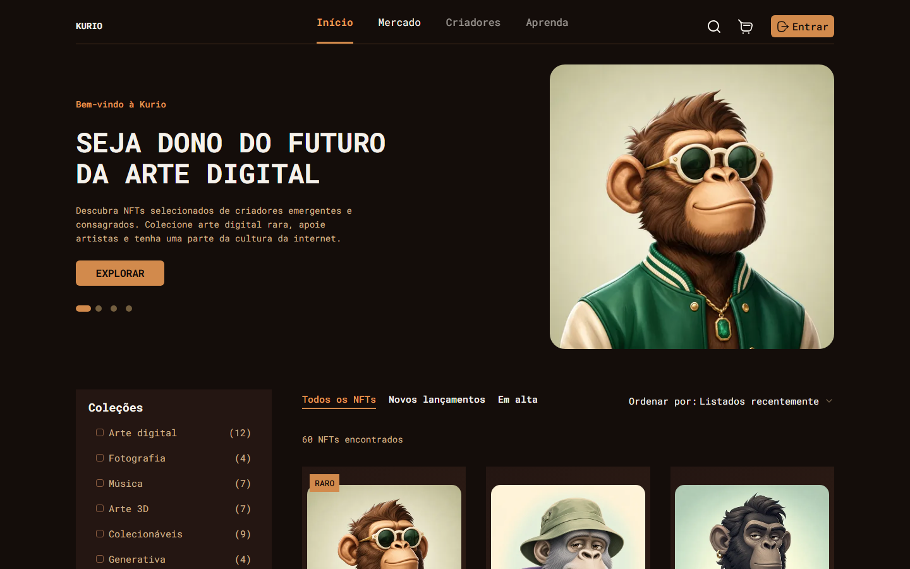

</div>

<br />

## Sumário

- [Telas](#telas)
- [O que a aplicação faz](#o-que-a-aplicação-faz)
- [Arquitetura em uma imagem](#arquitetura-em-uma-imagem)
- [Stack](#stack)
- [Começando](#começando)
- [Comandos](#comandos)
- [Credenciais fictícias](#credenciais-fictícias)
- [Cenários simulados](#cenários-simulados)
- [Como reproduzir os fluxos de falha](#como-reproduzir-os-fluxos-de-falha)
- [Qualidade](#qualidade)
- [Estrutura do projeto](#estrutura-do-projeto)
- [Documentação](#documentação)

A versão publicada corresponde à branch `main`. Repositório: [github.com/leccorside/desafio-junglegaming](https://github.com/leccorside/desafio-junglegaming).

## Telas

As imagens abaixo foram capturadas com o Playwright no build com mocks (desktop a 1440 px, mobile a 390 px). As de início, detalhe, carrinho e pagamento são as baselines da regressão visual; as da confirmação e do recibo vêm de uma compra completa com a Ana.

<table>
  <tr>
    <th width="72%">Desktop</th>
    <th width="28%">Mobile</th>
  </tr>
  <tr>
    <td></td>
    <td>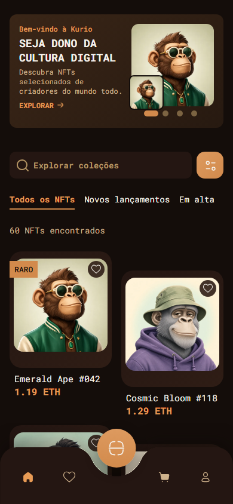</td>
  </tr>
  <tr>
    <td align="center"><sub><b>Início:</b> destaque, filtros por coleção, abas e ordenação</sub></td>
    <td align="center"><sub><b>Início</b> no celular</sub></td>
  </tr>
  <tr>
    <td>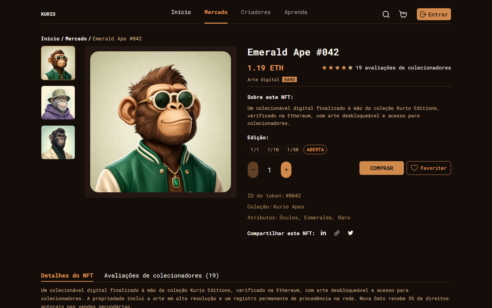</td>
    <td>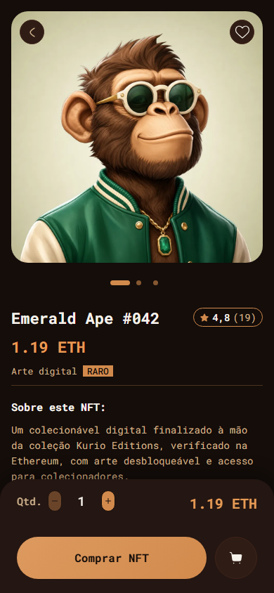</td>
  </tr>
  <tr>
    <td align="center"><sub><b>Detalhe do NFT:</b> edições, avaliações, quantidade e favoritos</sub></td>
    <td align="center"><sub><b>Detalhe</b> com barra de compra fixa</sub></td>
  </tr>
  <tr>
    <td>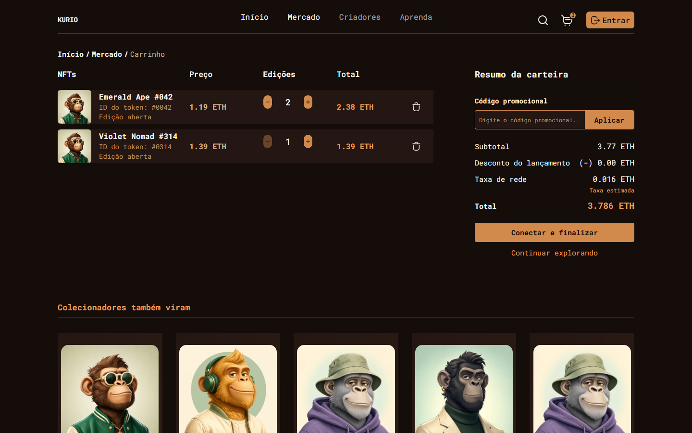</td>
    <td>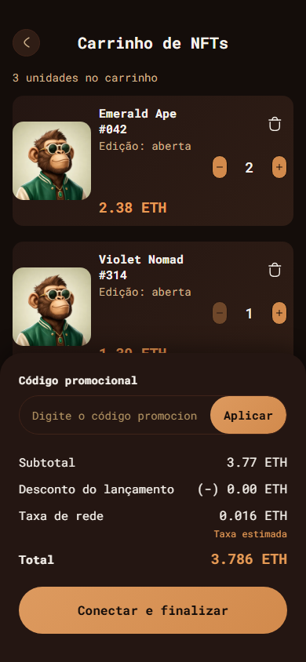</td>
  </tr>
  <tr>
    <td align="center"><sub><b>Carrinho:</b> cupom, taxa de rede e total em ETH</sub></td>
    <td align="center"><sub><b>Carrinho</b> no celular</sub></td>
  </tr>
  <tr>
    <td>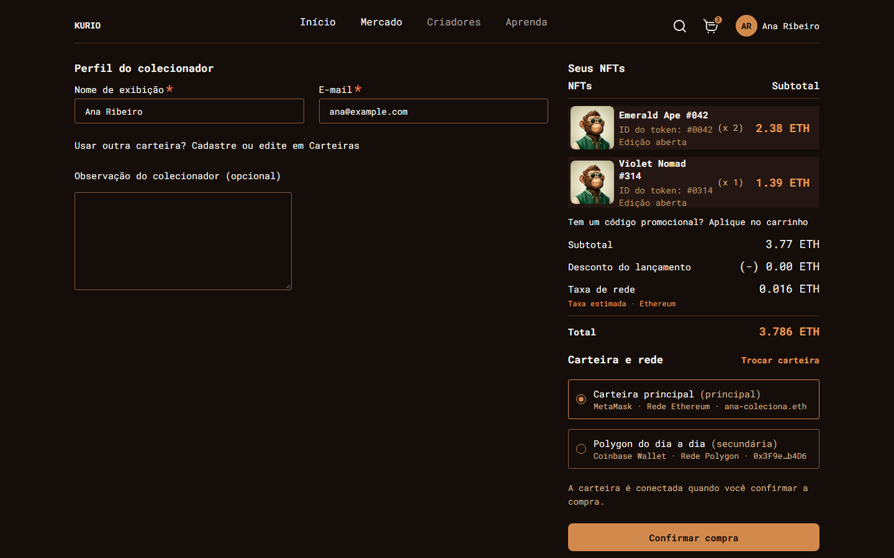</td>
    <td>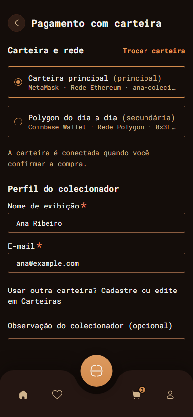</td>
  </tr>
  <tr>
    <td align="center"><sub><b>Pagamento:</b> dados do colecionador e escolha da carteira</sub></td>
    <td align="center"><sub><b>Pagamento</b> no celular</sub></td>
  </tr>
  <tr>
    <td>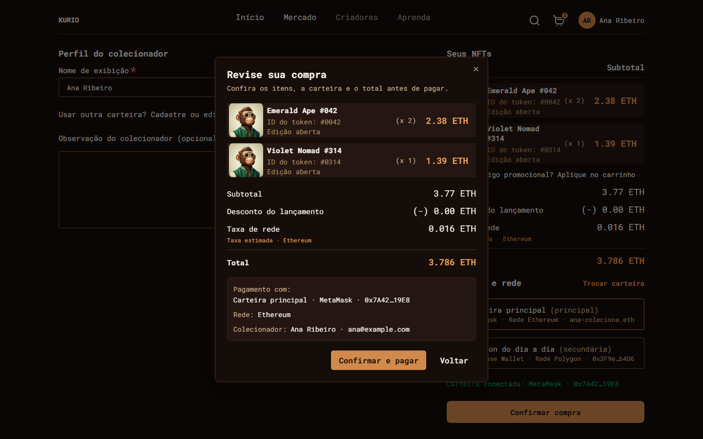</td>
    <td>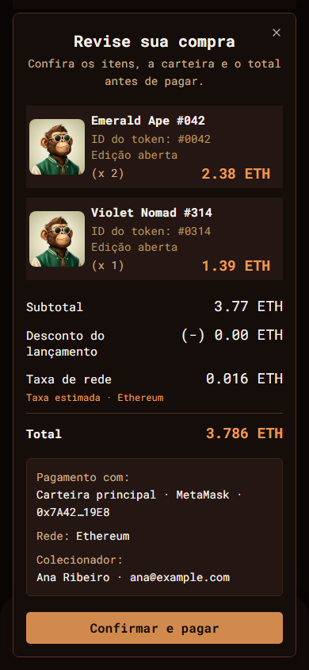</td>
  </tr>
  <tr>
    <td align="center"><sub><b>Confirmação:</b> revisão de itens, total e carteira antes de pagar</sub></td>
    <td align="center"><sub><b>Confirmação</b> no celular</sub></td>
  </tr>
  <tr>
    <td>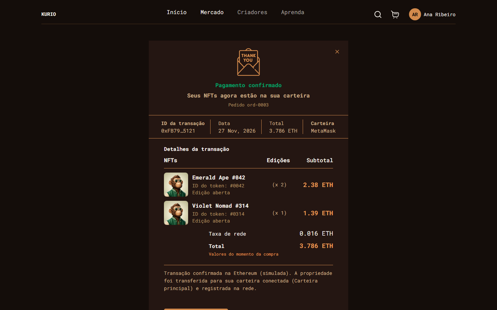</td>
    <td>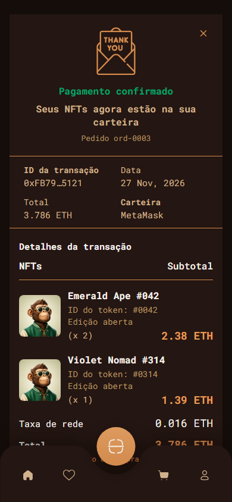</td>
  </tr>
  <tr>
    <td align="center"><sub><b>Recibo:</b> pagamento confirmado, com os valores do momento da compra</sub></td>
    <td align="center"><sub><b>Recibo</b> no celular</sub></td>
  </tr>
</table>

## O que a aplicação faz

| Área | Destaques |
| --- | --- |
| 🖼️ **Catálogo** | Busca, filtros por coleção, abas (todos, lançamentos, em alta), ordenação e paginação. Os filtros ficam na URL e a lista sempre mostra a resposta do último filtro, mesmo com respostas fora de ordem. |
| 🔎 **Detalhe** | Galeria, edições (1/1, 1/10, 1/50, aberta), avaliações, atributos e compartilhamento. Se a edição exibida esgota com a página aberta, a tela cai na mais barata e avisa. |
| 🛒 **Carrinho** | Funciona sem login e é mesclado à conta ao entrar. Cupons (`BEMVINDO10`, `FIXO005`), taxa de rede estimada e valores em ETH com `big.js` (18 casas, sem `number`). |
| 💳 **Checkout** | Cotação antes de confirmar, carteira simulada, pedido idempotente (timeout não duplica compra), pagamento pendente que sobrevive ao refresh e recibo ao confirmar. |
| 👤 **Conta** | Login, cadastro, perfil com avatar, troca de senha, carteiras, favoritos com atualização otimista e histórico de pedidos isolado por usuário. |
| ⚡ **Tempo real** | Eventos Socket.IO de preço e estoque, aviso do que mudou, reconexão automática com busca do que se perdeu e descarte de eventos duplicados ou antigos. |
| 🧪 **Cenários** | 19 cenários de falha escolhidos pela URL, por um painel na própria tela ou pela API de teste, para ver cada estado de erro sem mexer no código. |
| ♿ **Acessibilidade** | Navegação por teclado, foco gerenciado em diálogos e trocas de rota, avisos para leitor de tela e Lighthouse Accessibility 100. |

## Arquitetura em uma imagem

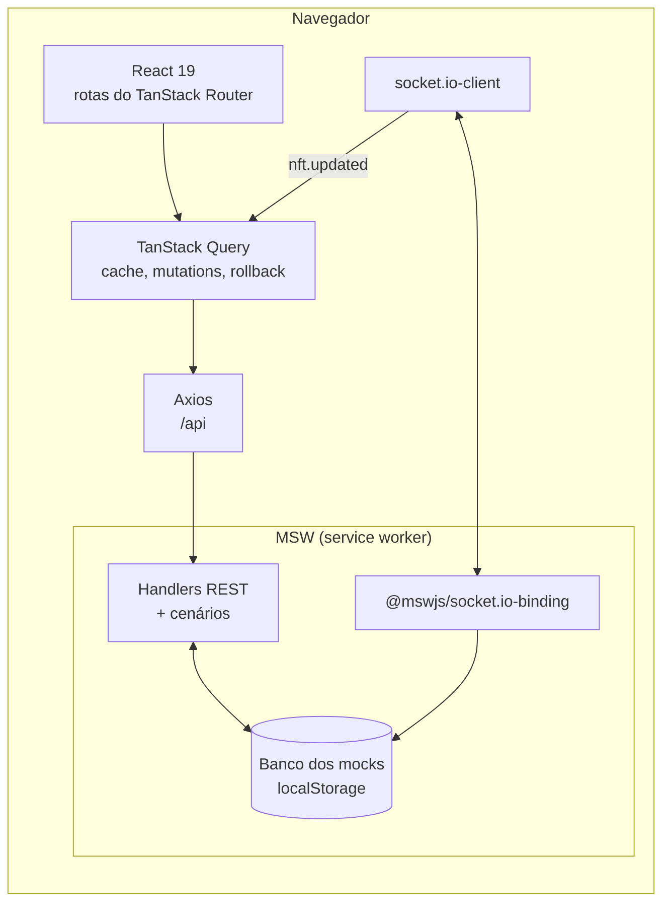

Os eventos em tempo real atualizam o cache do TanStack Query, e não a tela diretamente. Cada evento traz versão, então o app ignora repetidos e antigos e, depois de uma queda, busca pela API o que mudou. Os detalhes estão em [ARCHITECTURE.md](ARCHITECTURE.md) e [docs/REALTIME.md](docs/REALTIME.md).

## Stack

| Responsabilidade | Tecnologia |
| --- | --- |
| Interface | React 19 |
| Linguagem | TypeScript 6 |
| Build | Vite 8 |
| Roteamento | TanStack Router |
| Estado remoto | TanStack Query |
| Cliente HTTP | Axios |
| Tempo real | Socket.IO (`socket.io-client`) |
| Estilização | Tailwind CSS 4 |
| Componentes | shadcn/ui (Radix) |
| Mocking | MSW 2 + `@mswjs/socket.io-binding` |
| Formulários e validação | React Hook Form + Zod |
| Valores em ETH | big.js (string decimal, 18 casas) |
| Testes unitários e de integração | Vitest |
| Testes E2E e regressão visual | Playwright |
| Auditoria | Lighthouse |

## Começando

### Requisitos

- Node.js 22 ou 24 (`engines: ">=22 <25"`). O projeto é desenvolvido e publicado no 24, e o `.nvmrc` aponta para ele (`nvm use`).
- npm 10 ou superior (o lockfile versionado é o `package-lock.json`).

### Instalação

```bash
git clone https://github.com/leccorside/desafio-junglegaming.git
cd desafio-junglegaming
npm ci
npx playwright install chromium
npm run dev:mocks
```

Depois abra `http://localhost:5173`. O `npx playwright install chromium` baixa o navegador usado pelos testes E2E e pela auditoria Lighthouse (`npm run lighthouse` usa o mesmo Chromium).

### Variáveis de ambiente

O `.env` é opcional: sem ele, os comandos com mocks usam o `.env.mocks` versionado. Para ajustar as variáveis, copie `cp .env.example .env`.

| Variável | Padrão | Descrição |
| --- | --- | --- |
| `VITE_ENABLE_MOCKS` | `true` | Liga o MSW (REST e Socket.IO). Fica ligado também no build de demonstração. |
| `VITE_API_URL` | `/api` | Base das chamadas REST feitas pelo Axios. |
| `VITE_SOCKET_URL` | `ws://localhost/socket` | Endereço do Socket.IO interceptado pelo MSW. |
| `FIGMA_TOKEN` | (vazio) | Opcional. Token pessoal do Figma, só para `node scripts/export-figma-assets.mjs`, que reexporta ícones e imagens do layout. Os arquivos gerados já estão versionados. |

O arquivo `.env.mocks`, versionado, liga os mocks no modo `mocks`, usado pelo `dev:mocks`, pelos testes, pela auditoria e pelo deploy.

## Comandos

| Comando | O que faz |
| --- | --- |
| `npm run dev` | Servidor de desenvolvimento em `http://localhost:5173`. Os mocks seguem `VITE_ENABLE_MOCKS` do `.env`. |
| `npm run dev:mocks` | Servidor de desenvolvimento com os mocks sempre ligados (modo `mocks`). |
| `npm run build` | Typecheck e build de produção em `dist/`. Para o build de demonstração, com mocks: `npm run build -- --mode mocks`. |
| `npm run preview` | Serve o build em `http://localhost:4173`. |
| `npm run typecheck` | Verificação de tipos. |
| `npm run lint` | ESLint. |
| `npm run format` / `format:check` | Formata ou confere o código com Prettier. |
| `npm run test:unit` | Vitest: regras puras, contratos, cache e integração com a API simulada via `msw/node`. `test:unit:watch` roda em modo observação. |
| `npm run test:e2e` | Testes Playwright: gera o build com mocks, sobe o `preview` e roda os projetos desktop (1440 px) e mobile (390 px), com relatório HTML em `playwright-report/`. |
| `npm run test:e2e:update` | Atualiza as baselines de regressão visual. |
| `npm run lighthouse` | Auditoria Lighthouse do início e do detalhe, mobile e desktop, três medições cada, no build local com mocks (`vite preview`; relatórios em `lighthouse/reports/`). |
| `npm run lighthouse:prod` | A mesma auditoria contra a produção na Vercel, a medição oficial (relatórios em `lighthouse/reports/desafio-junglegaming-two.vercel.app/`). |

> [!NOTE]
> **Regressão visual em outro sistema.** As baselines versionadas são do Windows (`*-win32.png`), porque a renderização de fontes muda entre sistemas. Em Linux ou macOS, a primeira execução do `test:e2e` grava as baselines do sistema em vez de falhar, e as seguintes comparam com elas (na CI, com `CI=true`, a baseline precisa existir). As imagens de início, detalhe, carrinho e pagamento em [docs/images/](docs/images/) são cópias dessas baselines.

## Credenciais fictícias

| Usuário | E-mail | Senha |
| --- | --- | --- |
| Colecionador A (Ana Ribeiro) | `ana@example.com` | `Senha@123` |
| Colecionador B (Bruno Lima) | `bruno@example.com` | `Senha@123` |

As senhas ficam guardadas como hash no banco dos mocks. Também dá para criar uma conta nova em "Criar conta".

## Cenários simulados

Toda a API roda no navegador (MSW), com os dados persistidos no `localStorage` para sobreviver ao refresh. O cenário padrão tem latência curta variável (80 a 220 ms) e pagamento confirmado depois de 3 s.

| Como escolher | Como usar |
| --- | --- |
| 🔗 **Pela URL** | `?scenario=slow,payment-rejected`, com `&scenarioRoutes=/nfts` opcional para limitar os cenários de rede a uma rota da API. Os parâmetros saem da barra de endereço e o cenário fica salvo até o reset. |
| 🧪 **Pelo painel** | O botão com ícone de frasco no canto inferior esquerdo abre o painel de cenários. "Aplicar e recarregar" troca os cenários. O bloco "Estoque" esgota uma edição ou troca o preço sem recarregar, e a mudança chega à tela pelo evento em tempo real. No detalhe de um NFT, o bloco já abre no NFT e na edição da página. |
| 🛠️ **Pela API** | `PUT /api/__mocks/scenario` com `{ "names": [...], "options": {...} }`. As opções são `routes`, `latencyMs` (do `slow`), `seed` (do `jitter`) e `settleMs` (prazo do pagamento); `settleMs` só existe por aqui. |
| ♻️ **Restaurar** | Botão "Restaurar dados iniciais" do painel, que também apaga a sessão e o carrinho guardados no navegador e volta ao início. Pelo console, `fetch('/api/__mocks/reset', { method: 'POST' })` restaura só o banco e o cenário; a sessão e o carrinho do visitante continuam no `localStorage`. |

**Cenários disponíveis:** `slow`, `jitter`, `timeout`, `offline`, `server-error`, `flaky`, `empty-catalog`, `session-expired`, `forbidden`, `register-conflict`, `validation-error`, `favorite-fails`, `price-changed-on-checkout`, `sold-out-on-checkout`, `order-timeout`, `payment-confirmed`, `payment-rejected`, `wallet-rejected` e `wallet-disconnected`. O efeito de cada um está em [docs/MOCKS.md](docs/MOCKS.md).

**Cupons:** `BEMVINDO10` (10% do subtotal), `FIXO005` (0.05 ETH a partir de 0.5 ETH) e `EXPIRADO` (vencido).

## Como reproduzir os fluxos de falha

As rotas de teste (`/api/__mocks/...`) podem ser chamadas pelo console do navegador com `fetch`, na própria aba da aplicação. Os cenários de uso único disparam uma vez; para repetir, ative de novo. Clique em cada grupo para abrir a tabela.

<details>
<summary><b>🌐 Rede e carregamento</b> (10 casos)</summary>

| Falha | Como reproduzir | Resultado esperado |
| --- | --- | --- |
| Carregamento lento | `/?scenario=slow` | Esqueletos por 2,5 s em cada tela com dados, com aviso "Carregando…" para leitor de tela |
| Lento numa rota só | `/nft/nft-042?scenario=slow&scenarioRoutes=/nfts/nft-042` | Só o detalhe espera; o resto responde na hora |
| Respostas fora de ordem | `/?scenario=jitter` e mudar filtros rápido | A lista mostra sempre o resultado do último filtro |
| Falha transitória | `/?scenario=server-error` | Duas novas tentativas automáticas, depois erro com "Tentar de novo" |
| Recuperação após nova tentativa | `/?scenario=flaky` | A primeira carga falha e a nova tentativa funciona |
| Sem conexão | `/?scenario=offline` | Aviso de falha de conexão com "Tentar de novo" |
| Tempo esgotado | `/?scenario=timeout` | Aviso de tempo esgotado depois do timeout do cliente |
| Catálogo vazio | `/?scenario=empty-catalog` | Estado vazio com opção de limpar filtros |
| NFT inexistente | `/nft/nao-existe` | Página "NFT não encontrado" com caminho de volta ao catálogo |
| Rota inexistente | `/qualquer-coisa` | Página "Página não encontrada" |

</details>

<details>
<summary><b>🔐 Sessão, conta e permissões</b> (7 casos)</summary>

| Falha | Como reproduzir | Resultado esperado |
| --- | --- | --- |
| Sessão expirada | Entrar, abrir o painel, marcar `session-expired`, aplicar e abrir o perfil ou as carteiras | Volta ao login com "Sua sessão expirou. Entre de novo para continuar de onde parou." e retoma a tela depois de entrar |
| Acesso negado | Entrar com `?scenario=forbidden` e abrir `/orders/ord-0001` ou `/wallets` | O pedido aparece como não encontrado; as carteiras mostram erro com "Tentar de novo" |
| Pedido de outra conta | Entrar como Bruno e abrir `/orders/ord-0001` (pedido da Ana) | "Pedido não encontrado", sem nenhum dado do pedido |
| Conflito de cadastro | `/register?scenario=register-conflict` | Erro no campo e-mail |
| Erro de validação da API | `?scenario=validation-error` no cadastro, perfil ou carteiras | Erro no campo apontado pela API |
| Falha ao favoritar | `?scenario=favorite-fails` e clicar no coração | O coração volta ao estado anterior, com aviso. Com `slow` e `scenarioRoutes=/me/favorites` dá para ver a troca otimista antes de voltar |
| Carteira recusada | `?scenario=wallet-rejected` e conectar a carteira | Aviso de recusa e nova tentativa |

</details>

<details>
<summary><b>💳 Compra e pagamento</b> (7 casos)</summary>

| Falha | Como reproduzir | Resultado esperado |
| --- | --- | --- |
| Cupom inválido ou vencido | Aplicar `NADA` ou `EXPIRADO` no carrinho | Erro no campo do cupom |
| Preço alterado no checkout | `?scenario=price-changed-on-checkout` e confirmar a compra | A diferença aparece e é preciso confirmar de novo |
| Edição esgotada no checkout | `?scenario=sold-out-on-checkout` e confirmar | Item bloqueado e nova confirmação |
| Timeout depois de criar o pedido | `?scenario=order-timeout` e confirmar | "Verificar compra" recupera o mesmo pedido, sem duplicar |
| Pagamento recusado | `?scenario=payment-rejected` e confirmar | Recusa com motivo, carrinho intacto e "Tentar de novo" |
| Carteira desconectada | `?scenario=wallet-disconnected` e confirmar | Aviso para reconectar a carteira |
| Pedido pendente | No console, `fetch('/api/__mocks/scenario', { method: 'PUT', headers: { 'Content-Type': 'application/json' }, body: JSON.stringify({ names: ['payment-confirmed'], options: { settleMs: 30000 } }) })` e confirmar a compra | "Aguardando a confirmação do pagamento" por 30 s; recarregar a página ou derrubar a conexão não cria outro pedido, e o recibo aparece quando o pagamento confirma |

</details>

<details>
<summary><b>⚡ Tempo real</b> (5 casos)</summary>

| Falha | Como reproduzir | Resultado esperado |
| --- | --- | --- |
| Preço ou estoque muda com a tela aberta | Com o NFT no carrinho ou no pagamento, usar o bloco "Estoque" do painel (ou `POST /api/__mocks/nfts/nft-042/update` com `{ "editionId": "nft-042-open", "price": "1.55" }`) | A tela muda sem recarregar e um aviso diz o que mudou; no pagamento, a cotação é refeita antes de confirmar |
| Edição da tela esgota | No detalhe, "Marcar como esgotada" no painel para a edição exibida | A página cai na edição mais barata e avisa "A edição … está esgotada" |
| Queda e reconexão | `fetch('/api/__mocks/realtime/disconnect', { method: 'POST', headers: { 'Content-Type': 'application/json' }, body: JSON.stringify({ downMs: 5000 }) })` e mudar um preço nesse intervalo | Faixa "Atualizações em tempo real pausadas. Reconectando… Os preços podem ter mudado.", reconexão automática ("Atualizações em tempo real retomadas.") e busca, pela API, do que mudou enquanto a conexão estava fora |
| Evento duplicado | Mudar um preço e chamar `POST /api/__mocks/realtime/replay` | O evento repetido é ignorado (nenhum aviso ou busca a mais) |
| Evento antigo | `POST /api/__mocks/realtime/stale` com `{ "nftId": "nft-042", "price": "9.99" }` | O evento de versão antiga é ignorado: o preço não vira 9.99 |

</details>

Detalhes de cada cenário, das rotas de teste e da persistência estão em [docs/MOCKS.md](docs/MOCKS.md).

## Qualidade

### Testes

| Suíte | Volume | Cobertura |
| --- | --- | --- |
| Vitest | 219 testes em 21 arquivos | Regras puras, contratos Zod, cache e 44 testes de integração da API simulada via `msw/node` |
| Playwright | 454 testes em 22 specs (desktop e mobile) | Fluxos completos, cenários de falha, tempo real, acessibilidade com axe e regressão visual |

Na entrega, `npm run test:e2e` passou duas vezes seguidas do zero, sem novas tentativas, e também a partir de um clone limpo sem `.env`. Mais detalhes em [docs/TESTING.md](docs/TESTING.md).

### Lighthouse em produção

Medianas de três medições por página e perfil, na Vercel, em 27/11/2026.

| Página | Perfil | Performance | Accessibility | Best Practices | SEO | LCP |
| --- | --- | ---: | ---: | ---: | ---: | ---: |
| Início | 📱 Mobile | 🟢 92 | 🟢 100 | 🟢 100 | 🟢 100 | 2,49 s |
| Início | 🖥️ Desktop | 🟢 100 | 🟢 100 | 🟢 100 | 🟢 100 | 0,62 s |
| Detalhe | 📱 Mobile | 🟢 95 | 🟢 100 | 🟢 100 | 🟢 100 | 2,48 s |
| Detalhe | 🖥️ Desktop | 🟢 100 | 🟢 100 | 🟢 100 | 🟢 100 | 0,56 s |

As metas eram Performance ≥ 90, Accessibility ≥ 95, Best Practices ≥ 95 e SEO ≥ 90. O que foi feito para chegar lá, e o que foi testado e descartado, está em [docs/PERFORMANCE.md](docs/PERFORMANCE.md).

## Estrutura do projeto

```text
src/
├── api/          cliente Axios, schemas Zod dos contratos e erros tipados
├── components/   layout e componentes compartilhados (shadcn/ui)
├── features/     uma pasta por domínio, com componentes, hooks e queries
│   ├── account/      perfil, avatar, senha e carteiras
│   ├── auth/         login, cadastro e sessão
│   ├── cart/         carrinho, cupom e merge ao entrar
│   ├── catalog/      lista, filtros e busca
│   ├── checkout/     cotação, pedido e pagamento
│   ├── favorites/    favoritos otimistas
│   ├── nft-detail/   página do NFT e edições
│   ├── orders/       histórico e recibo
│   └── realtime/     Socket.IO, reconciliação e avisos
├── hooks/        hooks genéricos
├── lib/          utilitários (ETH com big.js, formatação, foco)
├── mocks/        MSW: handlers REST, Socket.IO, fixtures, cenários e banco
└── routes/       rotas do TanStack Router (arquivos)
tests/e2e/        specs do Playwright e baselines visuais
lighthouse/       script e relatórios da auditoria
docs/             documentação técnica e imagens do README
```

## Documentação

| Arquivo | Conteúdo |
| --- | --- |
| [ARCHITECTURE.md](ARCHITECTURE.md) | Arquitetura, contratos, sessão, carrinho, cache, reconciliação com o tempo real, decisões de UX, desvios do Figma e limitações |
| [CHANGELOG.md](CHANGELOG.md) | Histórico de versões |
| [docs/CONTEXT.md](docs/CONTEXT.md) | Contexto, objetivos e escopo |
| [docs/REQUIREMENTS.md](docs/REQUIREMENTS.md) | Requisitos funcionais e não funcionais |
| [docs/BUSINESS_RULES.md](docs/BUSINESS_RULES.md) | Regras de compra, carrinho, cupom, pagamento, carteira e pedido |
| [docs/API.md](docs/API.md) | Contratos REST |
| [docs/MOCKS.md](docs/MOCKS.md) | MSW, fixtures, cenários, rotas de teste e persistência |
| [docs/REALTIME.md](docs/REALTIME.md) | Eventos Socket.IO, reconexão e reconciliação |
| [docs/STATE_MANAGEMENT.md](docs/STATE_MANAGEMENT.md) | Cache, mutations, invalidação e rollback |
| [docs/SECURITY.md](docs/SECURITY.md) | Sessão, rotas protegidas e isolamento entre usuários |
| [docs/DESIGN_SYSTEM.md](docs/DESIGN_SYSTEM.md) | Identidade visual e componentes |
| [docs/ACCESSIBILITY.md](docs/ACCESSIBILITY.md) | Acessibilidade |
| [docs/USER_FLOWS.md](docs/USER_FLOWS.md) | Fluxos de uso |
| [docs/TESTING.md](docs/TESTING.md) | Testes unitários e Playwright |
| [docs/PERFORMANCE.md](docs/PERFORMANCE.md) | Lighthouse, resultados e otimizações |
| [docs/DEPLOYMENT.md](docs/DEPLOYMENT.md) | Build e publicação |

<div align="center">
<br />
<sub>Feito para o desafio frontend da Jungle Gaming · layout da marca KURIO no <a href="https://www.figma.com/design/Ff0SksUi7UFtPWUO8kyNtw/Frontend-Challenge?node-id=0-1">Figma</a></sub>
</div>
